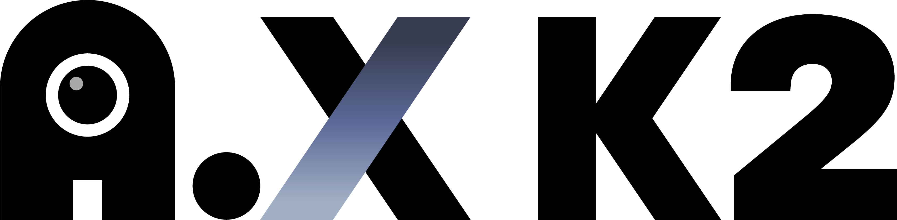
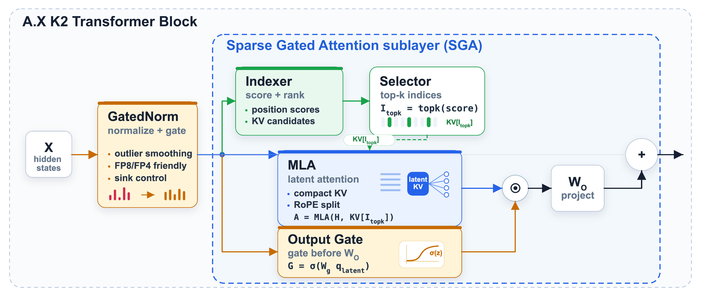
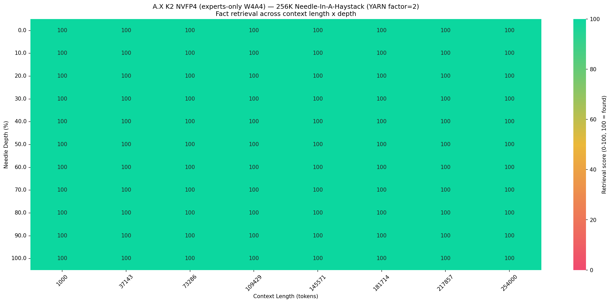

<div align="center">
  <picture>
    <source media="(prefers-color-scheme: dark)"
            srcset="./assets/A.X_K2_BI_Negative.png">
    
  </picture>
</div>
<br/>
<p align="center">
  <a href="https://huggingface.co/collections/skt/ax-k">🤗 Models</a> |
  <a href="https://github.com/SKT-AI/A.X-K2">🖥️ Github</a> |
  <a href="./A_X_K2_Tech_Report.pdf">📄 Technical Report</a>
</p>

## Model Summary

**A.X K2** is a large-scale Mixture-of-Experts (MoE) language model trained from scratch as a high-performance, **agentic** foundation model, and the successor to A.X K1.
The model contains **688 billion total parameters**, with **33 billion active parameters**, delivering strong reasoning and instruction-following performance while maintaining practical inference efficiency.

Through a **Think-Fusion** training recipe, a single unified model supports both a **thinking** mode for complex problem solving and a **non-thinking** mode for concise, low-latency responses, allowing the user to trade quality for cost on a per-request basis.

A.X K2 is developed as part of the Korean government's **Sovereign AI foundation model** project, aiming to build a frontier-scale model with deep understanding of the Korean language and culture.

## Key Features

- **Large-Scale Sparse MoE (688B / 33B Active)**
  Employs a high-capacity Mixture-of-Experts architecture (256 routed experts + 1 shared expert) that activates only 8 experts per token, enabling strong reasoning performance with practical inference efficiency. Relative to A.X K1, the number of routed experts increased from 192 to 256 while keeping the activated parameter count at 33B.

- **Hybrid Reasoning Control (Think / Non-Think)**
  Supports user-controllable reasoning depth via the Think-Fusion recipe, allowing explicit multi-step reasoning or concise low-latency responses within a single unified model.

- **Sparse Gated Attention (SGA) for Efficient Long-Context Inference**
  Combines a lightweight sparse-attention indexer (top-*k* token selection) with head-specific gated attention on top of Multi-head Latent Attention (MLA). This prunes attention computation at long context while suppressing attention sinks, delivering higher throughput and lower latency at long sequence lengths.

- **Gated Norm (GN) for Stable Training and Low-Precision Serving**
  Applies an input-dependent gate immediately after RMSNorm to suppress massive activations and hidden-state outliers. This stabilizes large-scale training and produces an outlier-friendly activation distribution favorable for low-precision (FP8 / NVFP4) deployment.

- **Native FP8 Training and FP8 Checkpoint**
  A.X K2 was trained from scratch **natively in FP8** (MXFP8, E4M3) for both the forward and backward passes, and the released checkpoint is distributed in **block-scaled FP8 (E4M3)**. This halves the memory footprint relative to BF16 and enables efficient FP8 serving out of the box, without a separate post-hoc quantization step.

- **Tokenizer Optimized for Multilingual and Code Data**
  Inherits the large-vocabulary BBPE-based tokenizer from A.X K1, optimized for token efficiency across five languages (English, Korean, Chinese, Japanese, and Spanish), with a strong emphasis on source code, structured text, and programming-related patterns.

## Model Details

- **Architecture:** Decoder-only Transformer with Mixture-of-Experts (MoE)
- **Total parameters:** 688B (256 routed experts + 1 shared expert)
- **Active parameters:** 33B per token (8 experts + 1 shared expert)
- **Number of layers:** 61 (1 dense + 60 MoE)
- **Number of attention heads:** 64
- **Hidden size:** 7168
- **Intermediate size:** 18432 (dense layer)
- **Expert intermediate size:** 2048
- **Attention:** Multi-head Latent Attention (MLA) with head-specific output gate and sparse attention (SGA)
- **Normalization:** Gated Norm (gating applied after RMSNorm) with QK-normalization
- **Vocab size:** 163,840
- **Context length:** 262,144 tokens (256K) — 128K trained natively, extended to 256K via YaRN scaling
- **Training precision:** Native FP8 (MXFP8, E4M3) forward and backward passes; FP32 master weights and gradients
- **Checkpoint precision:** Block-scaled FP8 (E4M3, 128×128 weight blocks with dynamic activation scaling)

## Architecture Highlights

<div align="center">
  
</div>

<p align="center"><em>The A.X K2 transformer block. A lightweight indexer scores and ranks key–value candidates, and the selector keeps the top-<em>k</em> indices; MLA then performs latent attention over the selected KV cache. A head-specific output gate modulates the attention output before the output projection, while Gated Norm precedes the sublayer to smooth outliers for stable, low-precision (FP8/FP4) computation.</em></p>

### Sparse Gated Attention (SGA)

A.X K2 combines two mechanisms into **SGA** to make long-context inference efficient while keeping training stable:

- **Gated attention:** A head-specific output gate is applied throughout pre-training on top of MLA. It introduces non-linearity into the attention output, mitigates attention sinks, and improves loss convergence.
- **Sparse attention:** A lightweight indexer scores and ranks key–value candidates and selects a small set of top-*k* tokens (*k* = 2048) per query, substantially reducing attention compute at long sequence lengths.

The two mechanisms are mutually reinforcing: by suppressing the attention-sink mass on uninformative tokens, the output gate yields a better-calibrated signal so the indexer spends its limited budget on genuinely relevant positions. In long-context serving (inputs beyond 64K tokens), A.X K2 with SGA sustains substantially higher token throughput, lower time per output token (TPOT), and lower time-to-first-token (TTFT) than both A.X K1 and A.X K2 with standard dense attention.

### Gated Norm (GN)

A.X K2 adopts **Gated Norm**, in which a learned, input-dependent gate modulates the normalized activation before it enters the residual stream. By preventing the normalized output from fitting outlier scalars, GN suppresses massive activations—hidden units orders of magnitude larger than the rest that persist across layers and are a documented source of both training instability and low-precision quantization error.

With this design, training remained sufficiently stable **without** the dual-normalization scheme used in A.X K1: the single post-normalization gating of Gated Norm subsumes the stabilizing effect of the earlier design while reducing architectural complexity. As an additional benefit, the outlier-friendly activation distribution improves block-scale utilization under narrow low-precision formats such as FP8 and NVFP4.

### Think-Fusion (Hybrid Reasoning)

A.X K2 uses a single model to generate responses where reasoning before the answer can be enabled or disabled depending on usage requirements. This is achieved through the **Think-Fusion** recipe, which unifies thinking and non-thinking training into a single track via a paired supervised fine-tuning (SFT) dataset, followed by multi-stage on-policy reinforcement learning.

- **Think mode:**
  Generates reasoning steps (`<think>...</think>`) before producing the answer for complex problem solving and multi-step inference.
- **Non-Think mode:**
  Generates concise, direct responses optimized for low-latency usage.

Rather than a dual-track strategy, A.X K2 unifies training into a single track using a paired SFT dataset in which each prompt is associated with both a thinking and a non-thinking response, so the model learns mode control from explicit control tokens rather than from category-specific artifacts.

## Training Data

A.X K2 was pre-trained on approximately **8.2 trillion tokens** of web text, source code, academic papers, STEM and Q&A material, books, and synthetic data, arranged as a three-stage, difficulty-increasing curriculum (6.4T general knowledge → 1.4T high-quality reasoning → 0.36T long-context extension). The designed language mix of the first stage is English 72.7%, Korean 15.4%, code 8.3%, and Japanese, Spanish, and Chinese at roughly 1% each; later stages shift further toward English and toward reasoning, agentic, and long-context data.

**Sources.** English web text comes from an aggregated corpus whose largest single contributor is [Nemotron-CC-v2.1](https://huggingface.co/datasets/nvidia/Nemotron-CC-v2.1); code comes from [Nemotron-Pretraining-Code-v2](https://huggingface.co/datasets/nvidia/Nemotron-Pretraining-Code-v2), and multilingual coverage from [FineWeb2](https://huggingface.co/datasets/HuggingFaceFW/fineweb-2). Korean web text comes from an in-house crawl (≈1.37T tokens), supplemented by an in-house PDF parsing pipeline and by synthetic data. These in-house components are proprietary and are not released. The datasets named here are the principal public ones rather than an exhaustive inventory; a number of smaller additional web sources are not listed individually.

**Curation.** Heuristic and model-based quality filtering with deduplication, domain-aware mixture and upsampling, and difficulty scoring for curriculum learning. Documents are scored for educational value and difficulty and partitioned by a domain classifier, with quality thresholds applied per domain rather than globally and tightened as training advances; a candidate pool of roughly 16.2T tokens was reduced to the 8.2T tokens actually trained on.

**Personal information.** Corpora collected in-house pass an internal PII masking pipeline before training: detected identifiers — primarily email addresses and numeric identifiers such as phone numbers — are replaced with type-specific placeholder tokens (for example `<|email|>`) rather than deleted, so surrounding text is preserved, and detection rules are maintained per identifier type and reviewed for false positives. The public datasets listed above are used as released and are not re-processed, since their publishers already apply their own PII handling.

**Data provenance.** The source and collection method of every corpus used in training are recorded in an internal dataset inventory, and each source is reviewed for its permitted scope of use. Web data collected in-house is gathered in accordance with robots.txt directives. The public datasets listed above are used under their published licenses, and third-party corpora are acquired under agreements that license them for model training and permit release of the resulting model, while prohibiting redistribution of the underlying data itself.

**Post-training.** Two supervised fine-tuning stages followed by multi-task RL and safety/red-teaming RL, using approximately **60.6B tokens** of paired thinking / non-thinking examples across agentic tool use, mathematics, knowledge and science, code, general chat, instruction following, and safety. Safety supervision builds on [ESSA](https://openreview.net/forum?id=Imcv0X7c36) (Evolved Safety Specification Alignment), which conditions data synthesis on evolved domain–task safety specifications and rewards safe completion over blanket refusal.

See the [technical report](./A_X_K2_Tech_Report.pdf) for the full data pipeline, mixture tables, and post-training recipe.

## Evaluation Results

### Thinking Mode

All models are evaluated in **thinking mode**. Benchmarks marked with an asterisk (*) are evaluated by [Artificial Analysis](https://artificialanalysis.ai). All benchmarks are reported as percentages. The best score in each row is shown in **bold**. See the [technical report](./A_X_K2_Tech_Report.pdf) for evaluation details.

| Domain | Benchmark | A.X K2 (688B-A33B) | A.X K1 (519B-A33B) | Qwen3.5 | Nemotron 3 Ultra | DeepSeek-V4 Flash | GLM-5.1 | Kimi-K2.6 | MiniMax M2.7 |
| --- | --- | ---: | ---: | ---: | ---: | ---: | ---: | ---: | ---: |
| Math | AIME26 | **97.1** | 91.3 | 92.5 | 85.4 | 96.7 | 95.4 | 95.4 | 88.8 |
| | Apex | **45.8** | 1.0 | 13.5 | 3.1 | 28.1 | 10.4 | 20.8 | 1.0 |
| | Apex-shortlist | **88.6** | 50.8 | 61.2 | 45.5 | 88.0 | 72.1 | 72.6 | 30.3 |
| | KMO26 (1st round) | 92.5 | 85.0 | 78.8 | 85.0 | **94.4** | 78.1 | 88.1 | 80.0 |
| Korean | KMMLU-Pro | **80.5** | 68.9 | 78.4 | 69.2 | 78.8 | 76.5 | 73.4 | 66.6 |
| | KoBALT | 73.0 | 51.0 | 69.9 | 59.1 | **75.3** | 72.0 | 66.0 | 51.4 |
| | CLIcK | **91.6** | 85.3 | 88.4 | 84.1 | 89.6 | 88.8 | 80.9 | 76.1 |
| Code | LiveCodeBench v6 (Feb–May) | 84.0 | 74.9 | 82.6 | 76.4 | **89.4** | 86.4 | 86.5 | 69.8 |
| | SciCode | 41.0 | 24.1 | 42.0 | 39.9 | 44.9 | 43.8 | **53.5** | 47.0 |
| Science & Knowledge | Humanity’s Last Exam | 27.8 | 8.3 | 27.3 | 26.6 | 32.1 | 28.0 | **35.9** | 28.1 |
| | GPQA Diamond | 85.6 | 76.4 | 89.3 | 86.7 | 89.4 | 87.0 | **91.0** | 87.0 |
| General | IFBench | 75.9 | 63.2 | 79.0 | 78.9 | **81.2** | 78.6 | 74.0 | 73.2 |
| | AA-LCR | 66.0 | 26.0 | 66.0 | 67.0 | 63.0 | 62.0 | **70.0** | 69.0 |
| Agentic | τ²-Bench* (Telecom) | **98.0** | 86.0 | 95.6 | 83.3 | 95.0 | 97.7 | 95.9 | 84.8 |
| | BrowseComp (≤10 searches) | 9.3 | – | 26.9 | 13.4 | 16.8 | **29.1** | 21.5 | 14.2 |

A.X K2 is strongest in the **Math** and **Korean** domains, achieving the best scores among all compared models on AIME26, Apex, Apex-shortlist, KMMLU-Pro, and CLIcK. Beyond final-answer benchmarks, A.X K2 scored **35/42 on IMO 2025**—reaching the gold-medal threshold with a perfect 7/7 on each of the first five problems—and produced **correct proofs for all 8 problems of the KMO26 2nd round**, using an iterative proof refinement method. It also achieves the best score on τ²-Bench Telecom among all compared models.

### Long Context

A.X K2 is trained natively to a 128K context via Adjusted Base Frequency (ABF) and extends to longer sequences through zero-shot YaRN scaling at inference. We assess long-context capability along two complementary axes—comprehensive understanding on **RULER** and long-range fact retrieval via **needle-in-a-haystack (NIAH)**. See the [technical report](./A_X_K2_Tech_Report.pdf) for details.

#### RULER

RULER measures long-context understanding across retrieval, multi-hop tracing, aggregation, and question-answering tasks at increasing sequence lengths. A.X K2 sustains strong performance out to 256K, achieving an overall average of 94.6.

| Model | 4K | 8K | 16K | 32K | 64K | 128K | 256K | Overall |
| --- | ---: | ---: | ---: | ---: | ---: | ---: | ---: | ---: |
| A.X K2 | 97.5 | 97.2 | 97.5 | 96.5 | 94.3 | 92.7 | 86.6 | 94.6 |

#### Needle-in-a-Haystack (NIAH)

NIAH probes exact fact retrieval by inserting a target fact (the "needle") at varying depths within a long context and asking the model to recover it. Under zero-shot YaRN scaling (scaling factors of 1, 2, and 4 for 128K, 256K, and 512K, respectively), A.X K2 attains a perfect retrieval score at every context length and needle depth—and does so even after NVFP4 (experts-only W4A4) quantization. The heatmaps below show the 256K and 512K results.

<div align="center">
  
  
</div>

<p align="center"><em>NIAH fact retrieval across context length (x-axis) and needle depth (y-axis): 256K (YaRN factor 2, top) and 512K (YaRN factor 4, bottom), under NVFP4 (experts-only W4A4) quantization. A.X K2 scores a perfect 100 at every position.</em></p>

## Usage

### Transformers

A.X K2 is **natively supported in Hugging Face Transformers**. The `axk2` architecture ships with the library itself, so neither `trust_remote_code=True` nor any custom modeling file is needed — see the [`axk2` model documentation](https://huggingface.co/docs/transformers/main/en/model_doc/axk2).

The integration was merged after the **v5.14.1** release, so until the next release is published, install Transformers from source. FP8 execution additionally needs the `kernels` package, which supplies the block-scaled FP8 matmul the checkpoint runs on:

```bash
# install torch first, built against your CUDA version
pip install git+https://github.com/huggingface/transformers.git accelerate "kernels>=0.15.2,<0.16.0"
```

```python
from transformers import AutoModelForCausalLM, AutoTokenizer

model_name = "skt/A.X-K2"
tokenizer = AutoTokenizer.from_pretrained(model_name)
model = AutoModelForCausalLM.from_pretrained(model_name, device_map="auto")

messages = [{"role": "user", "content": "A.X K2에 대해 간단히 소개해줘."}]
inputs = tokenizer.apply_chat_template(
    messages,
    add_generation_prompt=True,
    enable_thinking=True,  # omit or set False for non-thinking mode
    return_tensors="pt",
    return_dict=True,
).to(model.device)

outputs = model.generate(**inputs, max_new_tokens=1024)
print(tokenizer.decode(outputs[0][inputs["input_ids"].shape[-1]:], skip_special_tokens=True))
```

FP8 execution is configured by the checkpoint itself (`quantization_config` in `config.json`), so no separate quantization step is needed. It requires `accelerate`, the `kernels` package, and a GPU of compute capability 8.9 or higher (for example RTX 4090, H100, B200); on SM90 and newer, DeepGEMM kernels are used when available and the `kernels` Triton path serves as the fallback. On older GPUs — or when no GPU is visible — Transformers dequantizes the weights to bfloat16 automatically, which needs roughly 1.4 TB of memory for the full model.

For **runnable scripts** — a multi-GPU inference script, a SLURM batch template, hardware sizing, the FP8 kernel pre-check, and the air-gapped kernel recipe — see [`examples/transformers/`](./examples/transformers/README.md).

### vLLM

A.X K2 support is being prepared as an upstream **vLLM** pull request. Until it lands, install from our fork at [SKT-AI/vllm](https://github.com/SKT-AI/vllm), which is upstream vLLM **v0.23.0** plus A.X K2 support and nothing else:

```bash
git clone -b axk2-v0.23.0 https://github.com/SKT-AI/vllm.git
cd vllm
pip install -e .   # see the vLLM docs for build prerequisites
```

The `axk2` config and model are registered in-tree on that branch, so `--trust-remote-code` is not needed:

```bash
vllm serve skt/A.X-K2 --tensor-parallel-size <N> \
    --tool-call-parser hermes \
    --reasoning-parser deepseek_v3
```

The two parser flags are what turn tool calls and the thinking trace into structured fields on the OpenAI-compatible endpoint. `deepseek_v3` reads `enable_thinking` out of each request's `chat_template_kwargs`, so the mode is chosen per call; use it rather than `deepseek_r1`, which would classify a whole non-thinking answer as reasoning.

**Sizing.** Loaded, the FP8 weights occupy roughly **656 GiB of GPU memory** in aggregate, spread evenly across the tensor-parallel ranks, so choose `<N>` such that the node holds that much with room left for the KV cache. Every figure below was measured on our reference configuration — **four NVIDIA B300 GPUs (275 GB each) at `--tensor-parallel-size 4`** — which put 164 GiB of weights on each GPU and left a KV cache of about 968K tokens.

**Startup.** The first launch is dominated by one-time kernel work — DeepGEMM warmup and flashinfer JIT compilation — not by reading weights. On that configuration, with the checkpoint on shared Lustre storage, the weights loaded in about 3.5 minutes while the whole engine took about 25 minutes to come up. The DeepGEMM kernels are cached under `VLLM_CACHE_ROOT` (`~/.cache/vllm` by default) and flashinfer keeps its own cache; with both warm, a subsequent launch completed in under 6 minutes. Keep them on persistent storage. Because the kernels are JIT-compiled on first use, the node also needs a working compiler toolchain — `ninja` and `nvcc` must be on `PATH`, or the run fails *after* the weights are already loaded.

Do not expect the very first load to be the slow one: weight loading landed between 196 s and 221 s across every combination we measured — filesystem cache cold (verified 0% of the checkpoint resident) or warm, and `--load-format auto` or `fastsafetensors` — with no systematic effect from either. The default loader already reads at about 3.1 GiB/s on this storage, so there is nothing for `fastsafetensors` to recover; note also that vLLM disables GPU Direct Storage whenever the tensor-parallel size is greater than one, which is where its advantage would come from.

**Long context.** The 256K context works without extra flags, since the published `config.json` already carries the YaRN configuration. We verified needle-in-a-haystack retrieval at 32K, 128K, and 256K, at three needle depths each, on the four-B300 configuration above.

For **verification scripts** — a GPU-free wiring check, a generation smoke test, the needle-in-a-haystack test, and a SLURM batch template — see [`examples/vllm/`](./examples/vllm/README.md).

The branch is pinned to a released vLLM tag rather than tracking `main`; newer bases will be published as additional branches. We will update this section with the upstream PR link once it is submitted.

### Chat template

Both paths render the same `chat_template.jinja` from the checkpoint, which handles the thinking / non-thinking control tokens, tool calls, and reasoning retention across turns. [`examples/tests/`](./examples/tests/README.md) renders it directly and asserts on the result, covering the message shapes an OpenAI-compatible client sends; run it after any change to the template.

## Intended Use

A.X K2 is a general-purpose, text-only foundation model released as open weights under Apache-2.0 for both research and commercial use. Built as an **agentic** foundation model, it is intended for multi-step reasoning and tool use, Korean- and English-language assistant applications, software engineering, mathematics and knowledge-intensive question answering, long-context workloads up to 256K tokens, and further adaptation as a base model. Use **thinking mode** where accuracy matters more than latency, and **non-thinking mode** for latency- or cost-sensitive use.

As part of the Korean government's **Sovereign AI foundation model** project, A.X K2 is intended in particular to enable controllable, self-hosted AI adoption across Korean industry, government, and academia.

A.X K2 is a foundation model, not a finished application. Deployments should keep a human in the loop for consequential decisions and add application-level safeguards appropriate to their domain and jurisdiction.

## Out-of-Scope Use

A.X K2 has not been evaluated or certified for autonomous decision-making in high-stakes domains. It should not be the sole or primary basis for medical, financial-eligibility, employment, legal, law-enforcement, or safety-critical decisions.

We also ask users to refrain from using A.X K2 to generate unlawful content or material that infringes third-party rights, to produce targeted disinformation or impersonate real people or organizations, to circumvent its safety behavior for operational harm, or to process personal data without a lawful basis.

The model is text-only: image, audio, and video inputs are not supported. Its tokenizer and training data target five languages (English, Korean, Chinese, Japanese, and Spanish); use in other languages is untested.

## Limitations and Biases

- **Factual reliability.** A.X K2 may generate incorrect or misleading information due to its stochastic nature; verify outputs before relying on them.
- **Modality.** Text-only; no native multimodal understanding.
- **Language coverage.** Pre-training data is predominantly English (roughly 73–90% by stage) and Korean (roughly 6–15%), with Chinese, Japanese, and Spanish at about 1% each, so quality in the latter three is materially less validated. Being largely web text, the corpus also leaves knowledge of long-tail regional and specialist topics uneven.
- **Bias.** The model can reproduce social biases present in web-scale data, including stereotypes relating to gender, age, region, occupation, and nationality. Bias is one of nine dimensions judged during safety RL, but we did not run a dedicated quantitative bias or fairness evaluation — evaluate on your own population and task before deploying in bias-sensitive contexts.
- **Safety.** Safety alignment reduces but does not eliminate unsafe outputs; adversarial prompting may still elicit harmful content.
- **Agentic capability.** Agentic performance is moderate — A.X K2 trails the strongest compared models on BrowseComp — reflecting limited agentic RL during post-training. Evaluate long-horizon tool-use workloads before relying on them.
- **Evaluation coverage.** Reported benchmarks are predominantly English and Korean, and largely single-turn.

## Lightweight Models

If you are interested in using lightweight versions of A.X K2 for business applications or scalable deployment, please contact us at **[a.x@sk.com](mailto:a.x@sk.com)**.

## Contact

For questions about A.X K2 — including model behavior, deployment, and licensing — contact the A.X team at **[a.x@sk.com](mailto:a.x@sk.com)**. Please send reports of vulnerabilities, harmful outputs, suspected misuse, or copyright infringement claims to the same address.

## Citation

If you use A.X K2 in your research, please cite the technical report:

```bibtex
@techreport{axk2-2026,
      title={A.X K2 Technical Report},
      author={SK Telecom},
      year={2026},
      institution={SK Telecom},
      url={https://github.com/SKT-AI/A.X-K2/blob/main/A_X_K2_Tech_Report.pdf},
}
```
